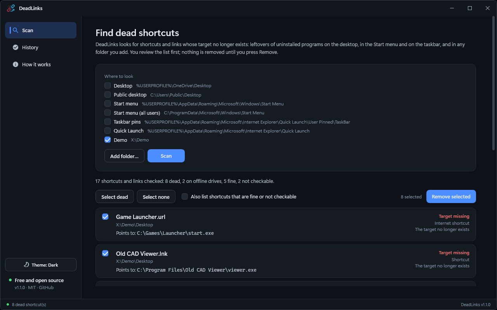
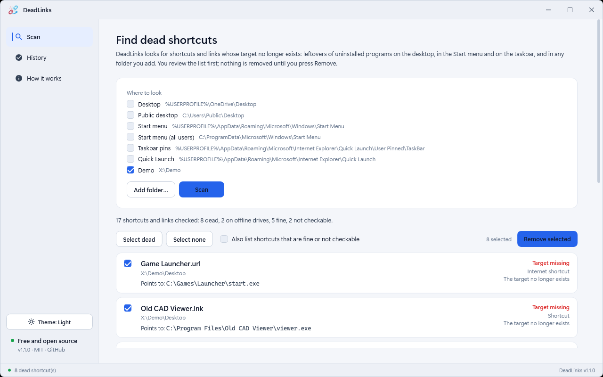

# DeadLinks — Broken Shortcut & Dead Link Cleaner

A Windows desktop tool (**.NET 10 / WPF**) that finds shortcuts and links whose target no longer exists, such as leftovers of uninstalled programs on the desktop, in the Start menu and on the taskbar, and in any folder you add. It shows where each one pointed and removes the ones you tick. You review the list and confirm first; shortcuts go to the Recycle Bin, a copy is kept, and every removal is logged and can be restored.



<details><summary>Light theme</summary>



</details>

## Download

Get the installer from the [latest release](https://github.com/md-anamul-hasan/deadlinks/releases/latest) (Windows 10/11, 64-bit; self-contained, no .NET install needed) and check it against `SHA256SUMS.txt`. Release builds are intended to be code-signed with a free certificate from the [SignPath Foundation](https://signpath.org/) (see [Code signing policy](#code-signing-policy)); until the project is approved, Windows SmartScreen may warn about an unknown publisher.

## What it does

| Area | Behaviour |
|---|---|
| What counts as dead | A shortcut (.lnk), an internet shortcut (.url) to a local file, or a symbolic link or junction whose target no longer exists on a connected drive. Environment variables in a target are expanded; moved targets are followed if Windows can still find them |
| Never guesses | Shortcuts on disconnected drives or network shares are listed as *Drive offline* and never ticked; Store apps, installer shortcuts, web addresses and unreadable locations are *Not checked* and cannot be selected |
| Where it looks | Desktop, public Desktop, Start menu, all-users Start menu and taskbar pins by default; **Add folder** searches any folder and its sub-folders. Links are never followed out of the tree |
| Safe removal | You review a ticked list and confirm. Shortcuts go to the Recycle Bin; symbolic links and junctions are deleted (only the link, never its target). A copy and a manifest are saved first and every removal is appended to `removal-log.csv` |
| History and restore | Every removal batch is listed; Restore puts shortcuts back (and recreates links where Windows allows). Anything that already exists again is left alone |
| No elevation | Locations that need administrator rights can be scanned; removing there fails with a clear message. DeadLinks never asks for elevation |
| Other | Dark/light/system theme, command line `DeadLinks.exe <folder>` scans just that folder |

### Command line

```
DeadLinks.exe <folder>
```
Scans just that folder.

Full walkthrough: [docs/USER_GUIDE.md](docs/USER_GUIDE.md).


## Build, test, run

```powershell
dotnet build DeadLinks.slnx
dotnet test  DeadLinks.slnx

# Self-contained installer in dist\installer (needs Inno Setup 6: winget install JRSoftware.InnoSetup)
.\scripts\build-installer.ps1

# Installer plus SHA256SUMS.txt in dist\release, ready to upload
.\scripts\package-release.ps1
```

The version comes from `Directory.Build.props`. Building needs the .NET 10 SDK; the installed app needs nothing else.

## Layout

```
Services/        scanner, shell-link reader, remover/restore, themes, window helpers
ViewModels/      MVVM: MainViewModel, ShellViewModel
Controls/        title bar, status bar
Themes/          design tokens (dark/light), controls, icons
DeadLinks.Tests/ xUnit: link classification, path display
scripts/         package-release.ps1 (exe + checksums), capture-media.ps1 + demo-fixture.ps1 (screenshots)
Directory.Build.props  single source of the product version
```

## Known limitations

- Web addresses inside internet shortcuts are not checked (DeadLinks never goes online).
- Pinned taskbar/Start items that live only in the registry (no shortcut file) are not scanned.
- Only Windows 10 (21H2+) and Windows 11, 64-bit.

## License

[MIT](LICENSE). Free for personal and commercial use.

## Code signing policy

Free code signing for release builds is provided by [SignPath.io](https://about.signpath.io/), with a certificate from the [SignPath Foundation](https://signpath.org/), once the project is approved.

- Releases are built and signed only by the GitHub Actions workflow `.github/workflows/release.yml` from tagged commits of this repository.
- Only DeadLinks's own binary and its installer are signed.
- Maintainer and approver: Md Anamul Hasan ([@md-anamul-hasan](https://github.com/md-anamul-hasan)).

## Privacy

Full policy: [docs/PRIVACY.md](docs/PRIVACY.md).

DeadLinks makes no network connections and has no telemetry or update check. The only files it writes are its removal log and the backup copies of shortcuts you remove, in `%APPDATA%\DeadLinks`.
